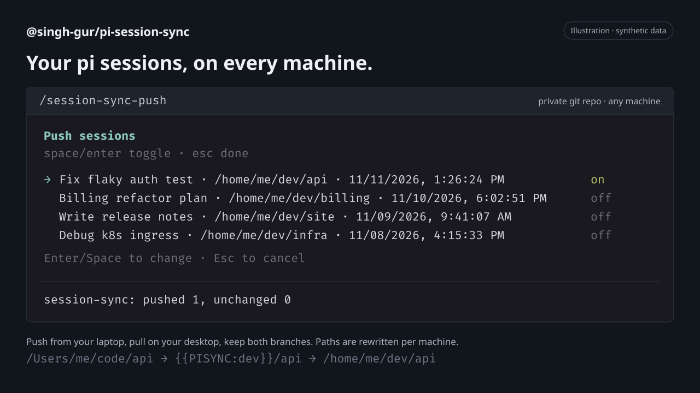

# pi-session-sync

**Start on your laptop. Pick it up on your desktop. Keep coding.**

Your [pi](https://pi.dev) sessions, on every machine. Push a conversation from one machine, pull it on another, and carry on exactly where you left off: same history, same `/tree`, with paths rewritten for the machine you're on. Everything travels through a private git repo you already own. No server, no account, no new service.

[Install](#get-started) · [Configure](#configure) · [How it works](#how-it-works) · [npm](https://www.npmjs.com/package/@singh-gur/pi-session-sync)



*Illustration of the extension's picklist with synthetic sessions. Colors and spacing depend on your terminal and pi theme.*

> [!WARNING]
> **Your sync repo must be private.** Sessions contain your prompts, code, tool output (file contents, command output) and possibly secrets such as API keys or tokens. They are not encrypted or redacted.

## Why you'll like it

- **Pick exactly what travels.** `/session-sync-push` and `/session-sync-pull` open a picklist with the current session pre-selected. Nothing moves without you choosing it.
- **Paths that follow you.** `/Users/me/code/api` on your Mac becomes `/home/me/dev/api` on your Linux box. Named roots turn machine paths into portable placeholders, so `/resume` finds the session in the right project.
- **Work on both machines, lose nothing.** Sessions are merged entry by entry. Continue the same conversation in two places and both branches show up in `/tree`, with the newest one active.
- **Your files stay the source of truth.** Pull never deletes local sessions, and the active session only reloads when the agent is idle.
- **Just git.** Any remote `git` can reach: GitHub, GitLab, Gitea, a bare repo over SSH. Authentication uses your existing git setup.
- **Hands-free if you want it.** Optional auto mode pulls the current folder's sessions when pi starts and pushes when you quit, configurable per root or folder. Off by default; startup pulls run in the background, and network failures only show a warning.

## Get started

```sh
pi install npm:@singh-gur/pi-session-sync
```

1. Create an **empty, private** git repo for your sessions.
2. Add the [config file](#configure) on each machine.
3. Start pi (or run `/reload`), then:

```text
/session-sync-push     # on the machine you worked on
/session-sync-pull     # on the machine you're moving to
```

Requires **Node.js >= 24.16**, **pi 1.x** (tested with 1.5.2), and `git` on your `PATH` with access to your sync repo. Install the package on every machine you want to sync.

<details>
<summary>Try without installing, install from GitHub, pin, or update</summary>

```sh
# Try it for the current run only
pi -e npm:@singh-gur/pi-session-sync

# Install from GitHub
pi install git:github.com/singh-gur/pi-session-sync

# Install from a local checkout
pi install /path/to/pi-session-sync

# Update installed pi packages
pi update --extensions
```

To pin a release, append `@<version>`, for example `npm:@singh-gur/pi-session-sync@0.1.0`. Pinned versions are skipped by package updates.

</details>

## Configure

Create `~/.pi/agent/git-session-sync.json` on each machine. It is machine-local and never synced.

```json
{
  "repoUrl": "git@github.com:me/pi-sessions.git",
  "branch": "main",
  "roots": { "dev": "/home/me/dev", "home": "/home/me" },
  "auto": { "pullOnStart": false, "pushOnShutdown": false }
}
```

| Key | Required | What it does |
| --- | --- | --- |
| `repoUrl` | yes | Any URL `git` can clone. Use an empty private repo. |
| `branch` | no | Branch to sync. Defaults to `main`. |
| `roots` | yes | Named root directories. Names use `a-z`, `0-9`, `_` and `-`; paths must be absolute. Only sessions under a root are synced. |
| `auto.pullOnStart` | no | When pi starts, pull new or changed sessions for the folder pi was started in, in the background. Defaults to `false`. |
| `auto.pushOnShutdown` | no | Push the current session when you quit pi. Defaults to `false`. |
| `auto.overrides` | no | Per-root or per-folder auto settings; see below. |

### Per-root and per-folder auto sync

`auto.overrides` keys are a root name (`dev`) or a root name plus a path under it (`dev/api`). Each entry sets `pullOnStart` and/or `pushOnShutdown`; unset fields fall back to the closest matching parent key, then to the global `auto` value. The longest matching key wins. Keys must start with a configured root name.

```json
"auto": {
  "pullOnStart": false,
  "pushOnShutdown": true,
  "overrides": {
    "dev":         { "pullOnStart": true },
    "dev/scratch": { "pushOnShutdown": false }
  }
}
```

Here `/home/me/dev/api` pulls on start and pushes on quit, `/home/me/dev/scratch` pulls but never auto-pushes, and folders under `home` only push. Folders outside every root never auto-sync.

### Same project, different paths

Give a root the **same name** on every machine and point it at that machine's folder:

| Machine | Config | Session cwd |
| --- | --- | --- |
| MacBook | `"dev": "/Users/me/code"` | `/Users/me/code/api` |
| In the repo | | `{{PISYNC:dev}}/api` |
| Linux desktop | `"dev": "/home/me/dev"` | `/home/me/dev/api` |

Every root path in a session (cwd, messages, tool calls and results) is replaced at path boundaries, with the longest matching root winning. Sessions that use a root name this machine doesn't define are skipped on pull, with a warning.

## Commands

| Command | What it does |
| --- | --- |
| `/session-sync-push` | Pick sessions to push. Lists sessions from the current directory by default (`Tab` toggles all directories). Only the current session is pre-selected. |
| `/session-sync-pull` | Fetch the repo and pick from sessions that are **[new]** or **[changed]** compared to your local copies. If the current session is updated, pi reloads it. |

In the picklist: `↑`/`↓` move, `Space` checks or unchecks a session, `a` selects all/none of the visible sessions, `Tab` switches between current-directory and all-directory sessions (push only; only visible checked sessions are synced), `Enter` syncs the checked sessions, `Esc` cancels. Each run ends with a summary: synced, unchanged, new entries, conflicts and anything skipped (with the reason).

## How it works

- **Merging.** Sessions are merged by entry id and ordered by timestamp, so the newest entry becomes the active leaf. If the same entry id has different content on each side, your local version is kept and the conflict is reported.
- **Local first.** Your session files are the source of truth. The clone at `~/.pi/agent/git-session-sync/repo` is a disposable cache, reset to the remote before every operation. Concurrent pushes from other machines are merged and retried automatically.
- **Safe writes.** Session files are written atomically, never outside pi's sessions directory, and never deleted.
- **Repo layout.** `sessions/<root>/<project>/<session-file>.jsonl`, readable and diffable like any other repo.

## Limitations

- POSIX paths only (no Windows).
- Only pi's default session directory is supported (no custom `sessionDir`).
- Sessions with a different session format version are skipped.
- The repo grows without bound (sessions can include base64 images).
- Path rewriting also changes coincidental matches of a root path inside message text.
- No encryption or redaction; see the warning above.

## Development

```sh
just install  # pnpm install --frozen-lockfile
just check    # typecheck + tests + pack dry run
just try      # run pi with the extension loaded
```

Release:

```sh
just check
just bump patch   # or minor / major: bumps version, tags, pushes
just publish      # pnpm publish to npm
```

Found a problem? [Open an issue](https://github.com/singh-gur/pi-session-sync/issues). Never paste session contents that may include secrets.

[MIT license](https://github.com/singh-gur/pi-session-sync/blob/main/LICENSE)
